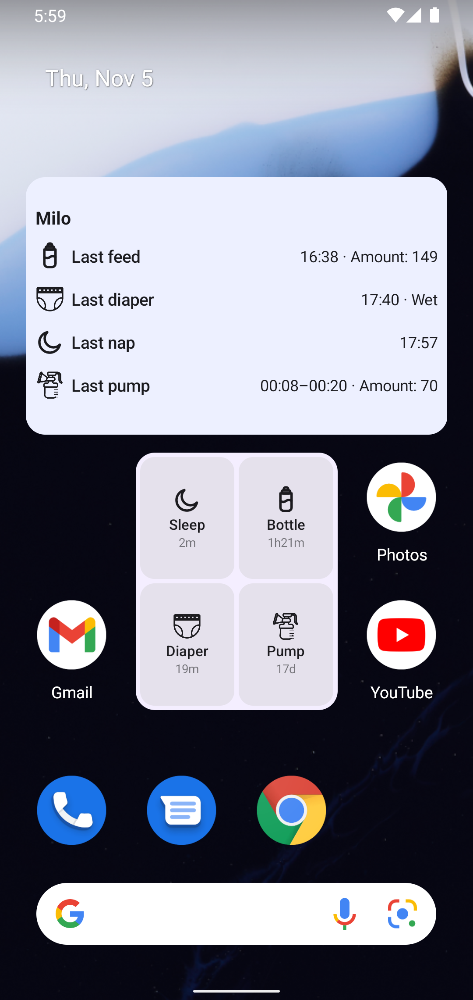
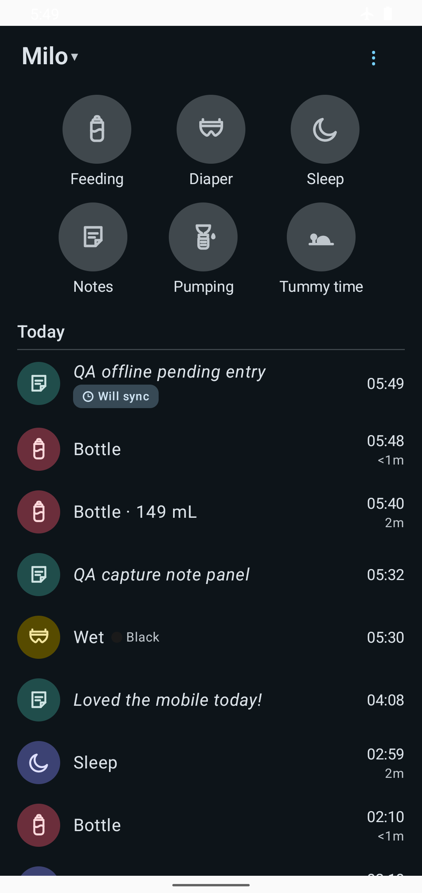
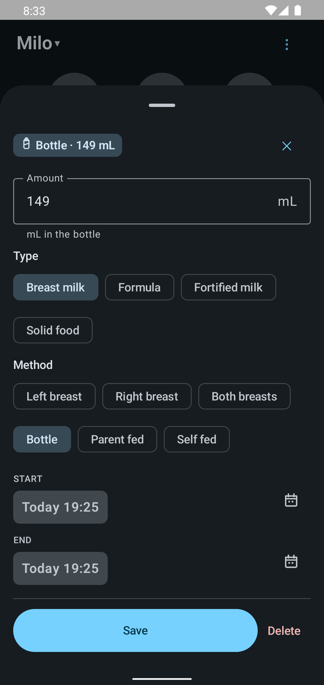

<div align="center">


# Dandle

An offline-first Android client for your own [Baby Buddy](https://github.com/babybuddy/babybuddy) server.

[](#build-it-yourself)
[](#get-started)
[](#privacy)
[](https://github.com/babybuddy/babybuddy)

**Requires access to an existing Baby Buddy server. Server hosting is not included.**

</div>

---

<div align="center">






</div>

---

## Overview

A native Android client for a self-hosted Baby Buddy server, built for one thing: **logging your baby's day should take seconds, even with no signal.** Six big buttons, timers that start and stop with a tap, native pickers when you need to fix a time, and everything saved on the phone first.

- ⚡ **Fastest-path logging** — six buttons on one screen; a diaper is two taps, a feed starts a timer with one.
- ⏱️ **Timers that forgive** — tap to start, tap to stop; under ten seconds it silently discards so a pocket-tap can't log a fake nap.
- ✏️ **Fix anything in the app** — tap an entry to change its time with a real clock-face picker; duration follows automatically.
- ☁️ **Offline-first, honest about it** — entries save locally and sync when your server is reachable; a rejected entry shows the server's reason with fix-or-delete right there.
- 📱 **Glanceable widgets** — start sleep, pumping, or tummy-time timers from the home screen; see every running timer and how long since the last feed, diaper, or nap.
- 🚪 **The escape hatch** — long-press any entry to open it on your server's web UI, where the full forms live. On purpose.
- 🔒 **Private by design** — direct to *your* server over validated TLS; token stored on-device with backup disabled; no ads, analytics, or developer backend.

Full guide: [logging](docs/guide/logging.md) · [timers](docs/guide/timers-and-editing.md) · [offline](docs/guide/offline.md) · [widgets](docs/guide/widgets.md) · [your data](docs/guide/data-and-privacy.md).

## Get started

1. Run a Baby Buddy server — one Docker line:
   ```bash
   docker run -d --name babybuddy -p 8000:8000 -v babybuddy_config:/config lscr.io/linuxserver/babybuddy
   ```
2. Install the app: `source scripts/dev-env.sh && cd app && ./gradlew :app:assembleDebug` (uses the Android Studio JBR; debug APK lands in `app/build/outputs/apk/debug/`). *No store release yet.*
3. Enter your server's address and login, pick your child, start logging.

## Build it yourself

Android Studio with its bundled JBR, then:

```bash
source scripts/dev-env.sh && cd app && ./gradlew :app:assembleDebug :app:testDebugUnitTest
```

Full dev environment notes: [AGENTS.md](AGENTS.md).

## How it's built

A human product owner sets scope and owns every decision; AI agents implement and test under narrow mandates; no UI change lands without a screenshot regression gate and a JVM regression test. The whole process — personas, briefs, QA findings, even the bugs — is [documented openly](docs/PERSONAS.md).

## Acknowledgements

Dandle is an **unofficial**, independent client for the open-source [Baby Buddy](https://github.com/babybuddy/babybuddy) server and is not affiliated with or endorsed by that project. Scope baseline and UX inspiration: [Baby Buddy for Android](https://github.com/babybuddy/babybuddy-for-android) — its breastfeeding icons are recreated here with credit. Docs pattern: [Baby Buddy Pocket](https://gitlab.com/idristel/Baby-Buddy-Pocket), another independent client worth using.

## License

Not yet chosen — the code is public for transparency; reach out before reuse.
