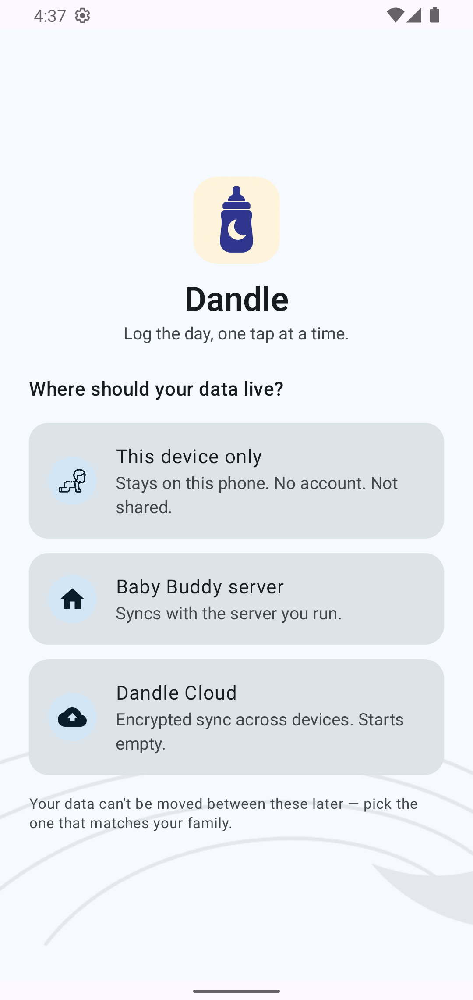
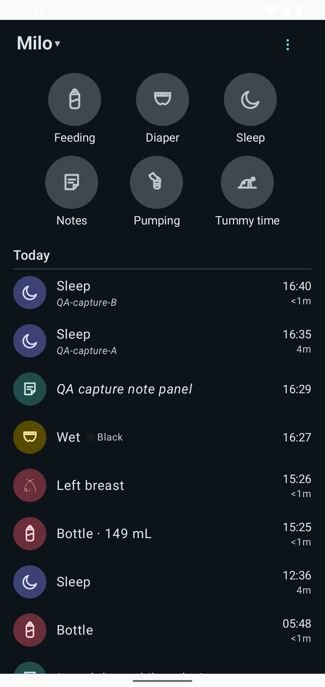
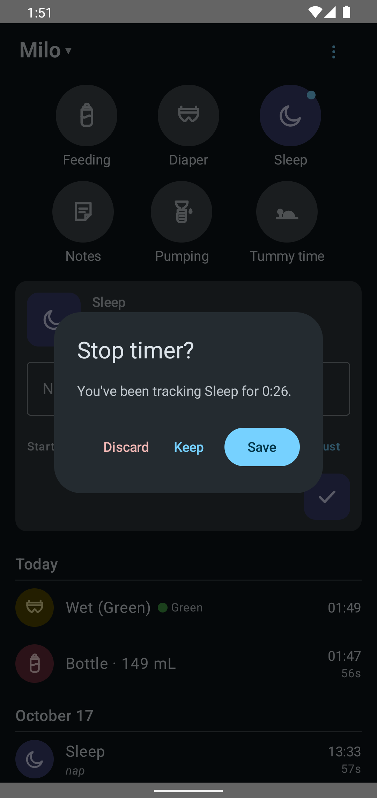
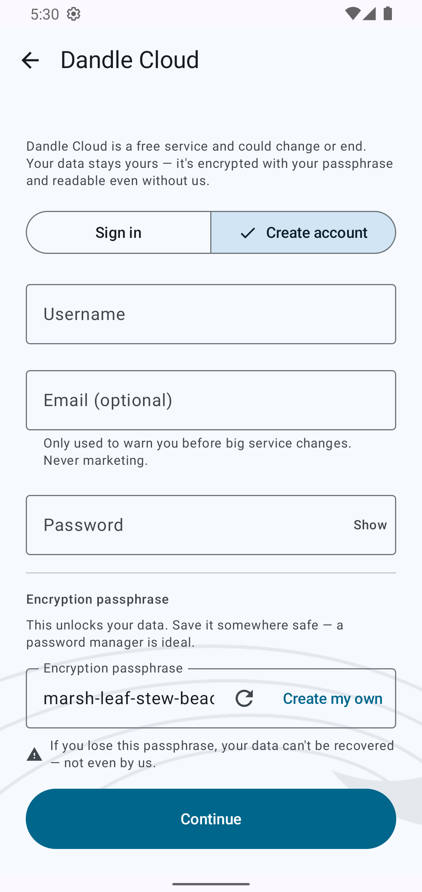
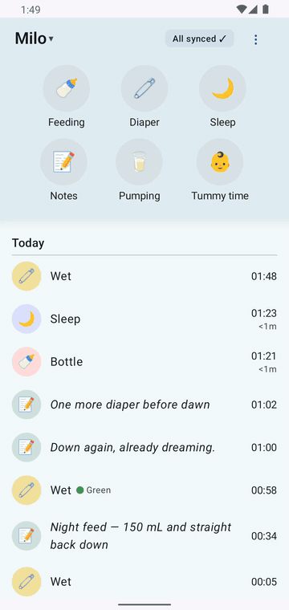
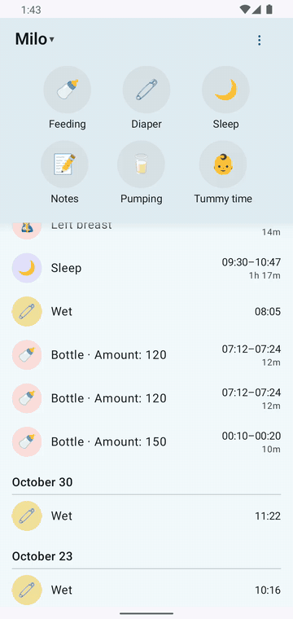
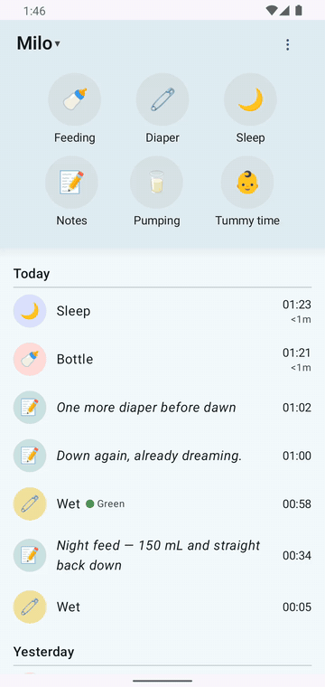
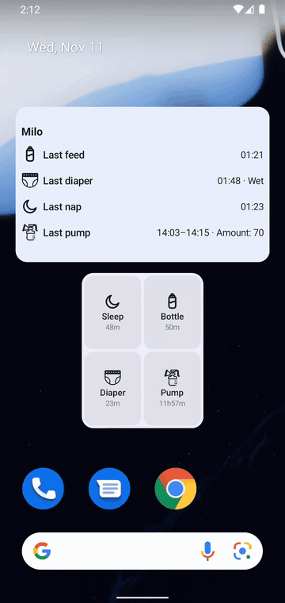
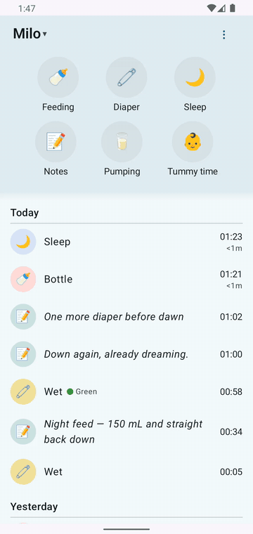

<div align="center">


# Dandle

Log the day, one tap at a time.

[](#build-it-yourself)
[](/../../releases)
[](#privacy--security)
[](/../../releases)

</div>

---

<div align="center">







</div>

---

## Three ways to use Dandle

One app, three backends — you pick where your data lives on first launch. **Your data can't be moved between these later**, so pick the one that matches your family.

### 📵 This device only

No account, no server, no network. Everything stays on this phone — private to it, wiped if you sign out. For a parent who just wants to log feeds and naps right now.

### 🏠 Baby Buddy server

For families who self-host [Baby Buddy](https://github.com/babybuddy/babybuddy): point Dandle at your server, sign in, and sync — entries, edits, and running timers reconcile automatically with everyone else using the same server. This is the original, battle-tested mode.

### ☁️ Dandle Cloud *(free)*

**A free hosted sync service** for families who want two phones to stay in sync without running a server.

Your data is **encrypted on this phone before it ever leaves it** — the server stores only ciphertext and can't read your entries, names, or amounts. You unlock it with an **encryption passphrase** that Dandle generates for you and you confirm by pasting it back — **if you lose that passphrase, your data can't be recovered, not even by us.**

Dandle Cloud is a free service and could change or end. Add an optional contact email and we'll warn you before any big change — and because your data is encrypted with your passphrase, it stays readable even without us.

## Highlights

- ⚡ **Fastest-path logging** — six big buttons on one screen; a diaper is two taps, a feed starts a timer with one.
- ⏱️ **Timers that forgive** — tap to start, tap to stop; under ten seconds it silently discards so a pocket-tap can't log a fake nap. Started on one phone, ended on the other? Sorted out automatically.
- ✏️ **Fix anything in the app** — tap an entry to change its time with a real clock-face picker; duration follows automatically.
- 📴 **Offline-first, honest about it** — airplane mode is a normal way to use this app. Entries save locally and sync when a connection exists; a rejected entry shows the server's reason with fix-or-delete right there.
- 📱 **Glanceable widgets** — start sleep, pumping, or tummy-time timers from the home screen; see every running timer and how long since the last feed, diaper, or nap.
- 🤱 **Feeding icons that mean it** — breastfeeding by side, bottle, solid food — each entry shows what actually happened.
- 🚪 **The escape hatch** *(server mode)* — long-press any entry to open it on your Baby Buddy web UI, where the full forms live. On purpose.
- 🔒 **Private by design** — no ads, no analytics, no developer backend. On-device mode never touches the network at all. Cloud mode can't read your data — see [Privacy & security](#privacy--security).

## Watch it happen

<p align="center">
  
  &nbsp;&nbsp;
  
  &nbsp;&nbsp;
  
</p>
<p align="center">
  
  &nbsp;&nbsp;
  
  &nbsp;&nbsp;
  
</p>

## Get started

Grab the latest APK from [Releases](/../../releases), install it, and pick your mode:

- **This device only** — add your baby's name and go. That's it.
- **Baby Buddy server** — run one if you don't have it:
  ```bash
  docker run -d --name babybuddy -p 8000:8000 -v babybuddy_config:/config lscr.io/linuxserver/babybuddy
  ```
  Then enter your server's address and login in the app.
- **Dandle Cloud** — create an account, **save the generated passphrase** (there's a paste-back check to make sure you did), add your baby, start logging.

Guides: [logging](docs/guide/logging.md) · [timers & editing](docs/guide/timers-and-editing.md) · [offline](docs/guide/offline.md) · [widgets](docs/guide/widgets.md) · [your data](docs/guide/data-and-privacy.md).

## Privacy & security

- **This device only** — data never leaves the phone. Sign out wipes it.
- **Baby Buddy server** — data goes to *your* server over a connection you control (HTTPS validated when your server supports it; plain-HTTP home-LAN use is supported with a clear warning first). Your API key is stored on-device with Android cloud backup disabled.
- **Dandle Cloud** — end-to-end encrypted: entries are sealed with AES-256-GCM under a key wrapped by your passphrase (Argon2id). The server stores ciphertext plus minimal timing metadata — nothing readable, by us or by anyone else. Your passphrase is never sent anywhere and cannot be recovered: **losing it means losing the data.**
- No ads, no analytics, no tracking, no developer backend in any mode.

## Build it yourself

Android Studio with its bundled JBR, then:

```bash
source scripts/dev-env.sh && cd app && ./gradlew :app:assembleDebug :app:testDebugUnitTest
```

Release builds sign with a local keystore (see the release signing block in `app/app/build.gradle.kts`); the password arrives via the `DANDLE_STORE_PASSWORD` environment variable and is never committed.

Full dev environment notes: [AGENTS.md](AGENTS.md).

## How it's built

A human product owner sets scope and owns every decision; AI agents implement and test under narrow mandates; no UI change lands without a screenshot regression gate and a JVM regression test. The whole process — personas, briefs, QA findings, even the bugs — is [documented openly](docs/PERSONAS.md).

## Acknowledgements

Dandle is an **unofficial**, independent client for the open-source [Baby Buddy](https://github.com/babybuddy/babybuddy) server and is not affiliated with or endorsed by that project. Scope baseline and UX inspiration: [Baby Buddy for Android](https://github.com/babybuddy/babybuddy-for-android) — its breastfeeding icons are recreated here with credit. Docs pattern: [Baby Buddy Pocket](https://gitlab.com/idristel/Baby-Buddy-Pocket), another independent client worth using.

## License

Not yet chosen — the code is public for transparency; reach out before reuse.
