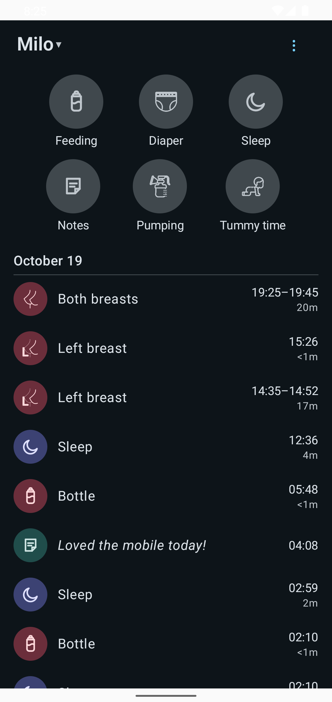

# About

Dandle is a **beta**. The core flows — logging, timers, editing, offline sync, widgets — work against a real server, and they got there the unfashionable way: a final QA acceptance pass on a real emulator against a real server that found nothing blocking, plus a standing rule that no UI change counts as done until the automated flow checks re-run green and the screenshots are regenerated.

:::note[Built for one hand, in the dark]

Dark by default, big buttons, works offline. Logging a diaper is three taps, and nothing decorative stands between you and the save.

:::

## Credits

- **[Baby Buddy](https://github.com/babybuddy/babybuddy)** (BSD-2-Clause) — the server this app connects to. This is an independent client, not affiliated with the Baby Buddy project.
- **[Baby Buddy for Android](https://github.com/babybuddy/babybuddy-for-android)** (MIT, © 2022 Paul Konstantin Gerke) — our scope baseline: the six buttons, the fast timers, the restraint. Nearly all artwork in this app is original. One deliberate exception: the breastfeeding side icons (left / right / both) are a close recreation of Baby Buddy for Android's icons, credited to the original project — for those shapes, clarity for a tired parent beats originality.

## How this is built

A human product owner sets the direction and makes every call. A small team of AI agents implements, tests, and QA-checks the work under that supervision — and nothing ships without screenshot-verified QA on a real emulator. The personas, their mandates, and how a feature moves from brief to done are documented in [PERSONAS.md](PERSONAS.md).
