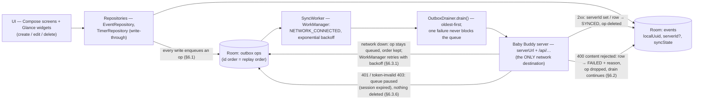
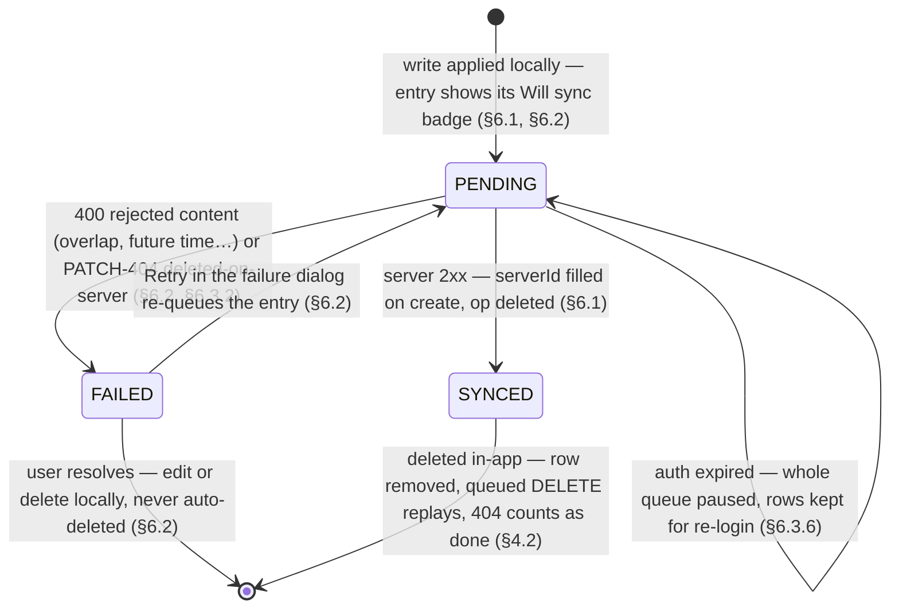

> **STATUS: Draft for the native-Kotlin contingency.** Framework decision pending (see docs/briefs/framework-eval/). The canonical product spec is docs/flows/new-app/00-functional-spec.md — framework-agnostic.

# Brief 00 — Architecture Blueprint

**Status:** Approved by Maintainer. All engineer work must fit this shape. Changes require Maintainer sign-off.

## Stack decisions

| Decision | Choice | Rationale |
|---|---|---|
| UI | Jetpack Compose + Material 3 (dynamic color) | Feature 3 "modern look"; single UI toolkit |
| Language | Kotlin 2.x, coroutines/Flow | Standard |
| Min/target SDK | 29 / 35 | Matches original app's floor; latest target |
| Networking | Retrofit + OkHttp (+ kotlinx-serialization) | Small, typed, mockable |
| Local store | Room | Offline-first source of truth |
| Settings | DataStore (Preferences) | serverUrl, apiKey, activeChildId |
| Background | WorkManager | Outbox drain, widget refresh |
| Widgets | Glance | Compose-style widgets |
| DI | Manual (`AppContainer` on `Application`) | No codegen; small app |
| Tests | JUnit + Robolectric + MockWebServer + Turbine | Deterministic, no emulator needed |

## Module/package shape (single Gradle module `:app`)

```
app.dandle/
  data/
    api/        Retrofit service, DTOs (field names EXACTLY per docs/research/babybuddy-api.md)
    auth/       LoginFlow: form login (csrf→session) → GET /api/profile → api_key
    local/      Room DB: events, timers(outbox-backed), children cache
    sync/       Outbox + SyncWorker + conflict mapping
    repo/       ChildRepository, EventRepository, TimerRepository (public API = Flows)
    settings/   DataStore-backed SettingsRepository
  domain/       Pure logic: Clock (injectable), ServerClockOffset, timer math, "time since last"
  ui/           theme/, login/, dashboard/, quickactions/, edit/, components/
  widget/       Glance widgets (Brief 05)
  App.kt, MainActivity.kt
```

## Core patterns

1. **Offline-first outbox.** UI writes to Room only (event row gets a local `uuid`, `serverId: Long?`, `syncState: SYNCED|PENDING|FAILED`, `failureReason: String?`). Every create/edit/delete enqueues an outbox op. `SyncWorker` (network-constrained, exponential backoff) drains ops oldest-first. Success → PATCH row with serverId, state SYNCED, delete op. HTTP 400 → state FAILED with server error text (DRF `{field: [msg]}` or `non_field_errors` — see research doc §conflicts) surfaced in UI. Connectivity restored → retry; FAILED entries never auto-delete.
2. **Timers run locally.** A running timer is a Room row (`startedAt`, child, kind). Ticking is client-side; stopping enqueues the entry create (start/stop from local timestamps). When online, starting a timer ALSO creates a server timer (so the web UI shows it) and stores its serverId; offline it just runs locally and syncs on completion. Server-timer cleanup on stop: original DELETEs the server timer — replicate when online.
3. **Server clock offset.** Capture server `Date` header on every successful response; compute offset; use it when stamping "now" for entries (same trick as the original app). Injectable `Clock` in tests.
4. **Long-press = web escape hatch.** Any entry long-press opens `{serverUrl}/{uiPath}/{serverId}/` (paths per research doc §deep links). Entries without a serverId (offline) long-press → disabled state (tooltip/none).
5. **Tap = quick edit (Feature 1).** Tapping an entry opens a Material 3 bottom sheet with type-appropriate fields (Brief 04). This is the deliberate UX addition vs. the original app.

## Cleartext HTTP

Debug builds allow cleartext (self-hosted servers are often plain HTTP on LAN). Release builds: network security config permitting user-decided cleartext is a post-beta decision — for beta, allow cleartext with a warning at login like the original app.

## Out of scope (beta)

Accounts/onboarding beyond login, backgrounds/media sync, medication/measurements (weight/height/temp) CRUD, tags, reports/graphs, multi-user profiles, QR device-transfer, iOS.

## Appendix: queue + data-flow diagrams (2026-10-18)

Every arrow below is code-backed: wiring in `data/AppContainer.kt`, drain semantics in `data/sync/OutboxDrainer.kt` + `SyncWorker.kt`, write-through in `data/repo/EventRepository.kt`; spec sections cited inline.

### Data flow: UI → Room → outbox → server



### Queue-entry state machine (`SyncState`, spec §6.1–6.3)



