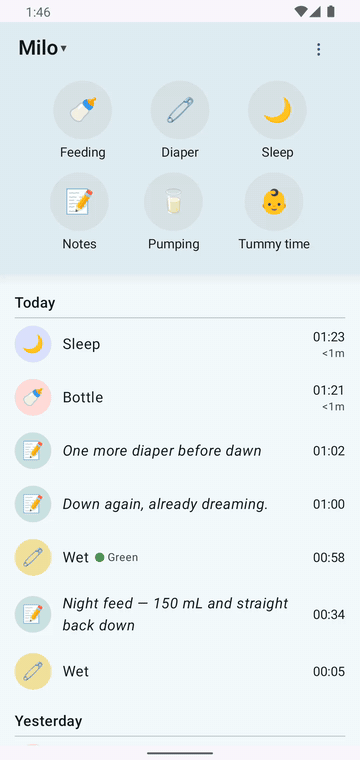

# 10 — Login (spec §1.1–1.2) — QA flow doc

**Purpose:** prove the fresh-install path (clear data → login screen → cleartext warning → dashboard) and the wrong-password branch, fully scripted, with the server-side request chain verified.

## How to verify

- Script: `scripts/qa/fresh-install-login.sh` (defaults: `net.babybuddy.next.debug`, `http://10.0.2.2:8000`, `admin`/`admin`). Exit 0 only when the `dashboard` tag is visible. Add `--pass wrongpass` for the failure branch (script exits 2 and prints `login/error_banner` text).
- Tags: `login/server_url`, `login/username`, `login/password`, `login/submit`, text node `Continue` (cleartext dialog), `login/error_banner`, `dashboard`.
- Logs: `scripts/qa/applog.sh` (`BB/LOGIN`, OkHttp), `scripts/qa/server-log.sh -f`.
- Expected server requests: `GET /login/` (csrf) → `POST /login/` 302 → `GET /api/profile` → `GET /api/children/?limit=1` → full sync chain (`GET /api/children/?limit=100`, `GET /api/{feedings,changes,sleep,notes,pumping,tummy-times}/?limit=50…`). No other 4xx.

## Observed (2026-10-16, build on emulator-5554)

1. `fresh-install-login.sh`: force-stop → `pm clear` → animations off → launch → typed all three fields by tag (fresh dump per field) → cleartext dialog ("Continue" tapped) → dashboard. Exit 0. One full run ≈ 25 s.
2. Server log shows exactly the chain above (verified line-by-line; see screenshots/`server-log.sh -n 25` at run time).
3. Wrong-password run (`--pass wrongpass`, full fresh install): error banner **"Wrong username or password."** in `login/error_banner`; username + password fields get error styling; URL field stays clean — matches UX spec §1 state table.
4. Persisted-credential skip verified: with valid stored session, `fresh-install-login.sh --keep-data` finds no login screen (app goes straight to dashboard) — spec §1.6.
5. Child switcher defaults to first child (Milo) and the selection persists across restarts (verified after switching to Zoe and force-stopping: switcher still "Zoe", screenshot `docs/screenshots/new-app/flows/02-dashboard-04-child-zoe.png`).

**Watch it happen — child switching.**

*12 s — the picker lives under the header chevron; each switch re-renders the quick actions and timeline for the selected child.*

## Branches / states

| State | Result |
|---|---|
| Fresh install, correct creds | Dashboard, session persisted |
| Fresh install, wrong password | `login/error_banner` "Wrong username or password." |
| `http://` URL | Cleartext dialog, Continue proceeds |
| Stored session, relaunch | Login skipped |

## Screenshots

Committed flow set (`docs/screenshots/new-app/flows/`):

- `01-login-01-initial.png` — fresh-install login screen
- `01-login-02-cleartext-dialog.png` — `http://` cleartext warning (Continue proceeds)
- `01-login-03-error-banner.png` — wrong-password banner
- `02-dashboard-01-idle.png` — dashboard after login
- `99-final-dashboard.png` — final dashboard state

## Deviations from spec

- None in the login flow itself. (See `99-qa-findings.md` #10: after a data wipe the app does not fetch `/api/timers/` at login, so a server-side orphan timer is invisible until the next restart.)
