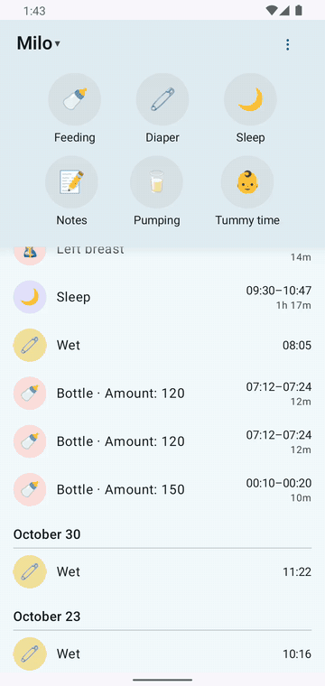

# 30 — Timeline + Quick Edit (spec §4–§5) — QA flow doc

**Purpose:** verify timeline structure (day groups, §4.1 headlines, durations, pull-to-refresh, pagination order) and the Quick Edit sheet (steppers, duration-preserving start moves, inline validation, delete-with-confirm, server PATCH).

## v0.4 — owner UI rework (supersedes stepper statements below)

Decisions: `docs/flows/new-app/90-owner-ui-rework.md` (U6–U8, U11). What changed:

- **Native pickers, no steppers.** Each time row (`edit/sheet/time_start`, `edit/sheet/time_end`, or `edit/sheet/time_time` for untimed types) shows the stored value; tapping it opens the Material **TimePicker pre-populated**; the calendar button opens the **DatePicker** then the TimePicker. `edit/stepper/*` tags no longer exist. Start moves stay duration-preserving; validation unchanged. The sheet's inner tags now reach the dump (`dialogTestTags()`), so `edit/save`, `edit/delete`, `edit/retry` are tappable by tag.
- **Driving the picker from UiAutomator** (`capture-flows.sh` → `pick_time <tag> <HH24> <MM>`): AM/PM by text, the hour via the dial node `content-desc="N o'clock"` (lowest match — the big field shares the description), the exact minute by a short **drag** ending at the minute's angle on the dial (a tap snaps to 5-minute labels); then `OK`.
- **Type-colored icon chips** on every row (Brief 03 §3). **FAILED** rows carry a small warning badge on the icon's corner (`dashboard/badge_failed` sits on the badge; tapping the row opens the failure dialog) — rows keep their normal height; there is no "Sync failed" pill and no header chip for failures. PENDING keeps the "Will sync" pill.
- **Notes are italic**: note headlines and note previews on other types' rows.

Screenshots: `04-edit-01-feeding-sheet` (picker rows), `04-edit-02-feeding-picked` (value changed through the picker), `05-sync-states-04-failed-badge` (badge on icon), `05-…-05-failure-dialog`, `05-…-06-resolved-synced`.

How to verify (scripted): group 04 (canaries A2a value changed via picker, A2b row updated in place ≤10 s) and group 05 (overlap → FAILED badge → edit END back via picker → retry → badge cleared).

## How to verify

- Login + at least one entry of each type (see `20-quick-actions.md`).
- Tags: `dashboard/timeline`, `dashboard/timeline/<localUuid>`, `dashboard/timeline/server:<TYPE>:<id>`, `dashboard/day_header`, `dashboard/badge_pending`, `dashboard/badge_failed`. **All `edit/*` tags (sheet, steppers, save, delete, validation) are defined in TestTags.kt but absent from the a11y tree — QA finding #8** — drive the sheet via fresh `uiautomator dump` bounds (buttons identified by text: `−15m/−1m/+1m/+15m`, `Save`, `Delete`, `Today HH:MM`).
- Server: `scripts/qa/api.sh GET /api/<type>/<id>/` after each edit; `scripts/qa/server-log.sh` must show `PATCH /api/<type>/<id>/` (never PUT) for saves and `DELETE /api/changes/<id>/` for deletes.

## Observed

### Timeline structure
- Day groups render ("Today", "Yesterday" verified; date headers not reachable in seed range). Trailing time column, observed formats (re-verified 2026-10-18): entries >5 minutes (or crossing local midnight) show a start–end range with the duration on the second line (`21:38–22:00` / `22m`); shorter entries show plain time-of-day; sub-minute durations render `<1m` (never bare seconds like `46s`) ✓.
- Headlines match §4.1: `Bottle · 120 mL`, `Bottle · 3 mL`, `Sleep` (+ note preview "QA night nap"), `Pump · 85 mL`, `Tummy time · Rolled over!` / `· Grabbed toy`, note first line ("Loved the mobile today!", "Pediatrician called — next checkup Nov 14."), diaper `Wet` / `Wet + Solid (Yellow)` + swatch. **Exception:** diaper headlines carry a redundant "(Color)" parenthetical — finding #6.
- Pull-to-refresh triggers the sync chain (verified via `GET /api/feedings|changes|…` in server log after swipe).
- Ordering is newest-first within each group.

### Quick Edit sheet
- Tap a timeline row → sheet opens with type-appropriate fields, mirroring §3 (diaper: wet/solid/color/amount + single TIME row; sleep/feeding/pumping/tummy: type fields + START and END rows) ✓ UX §4 anatomy.
- **Steppers:** diaper TIME `−15m` ×2 moved 22:17 → 21:47 → `PATCH /api/changes/9/` 200, time exact, all other fields intact ✓.
- **Duration-preserving start move:** feeding sheet, START `+15m` → START 22:22 **and END auto-shifted to 22:25** (duration 3 m preserved) → `PATCH /api/feedings/11/` 200 with `duration "00:03:07"` unchanged ✓ (spec §5).
- **Inline validation:** END `−15m` ×2 below START → message **"End time must be after start time."** shown; Save tapped → no PATCH fired, sheet stays open (save correctly blocked) ✓.
- **Delete:** sheet Delete → confirm dialog "Delete entry? / This removes it from the app and the server." (Cancel/Delete) → confirm → `DELETE /api/changes/10/` 204, row removed in place immediately ✓ (spec §4.2).
- Edit save updates the row in place (times in rows changed after edits: 22:22, 21:47 visible) ✓.

**Watch it happen — a quick edit.**

*31 s — START moved through the native dial; the row re-renders as 19:25–19:45 (duration preserved) without leaving the timeline (`PATCH /api/feedings/90/` 200).*

## Branches / states

| Branch | Result |
|---|---|
| Edit time (non-timed) | PATCH, row updates |
| Move START of timed entry | END shifts, duration preserved |
| END before START | Inline reason, Save blocked |
| Delete | Confirm dialog → server DELETE → row gone |
| Edit rejected by server | **BROKEN — see finding #3** |

## Screenshots

`docs/screenshots/new-app/flows/04-edit-01…04` — edit sheet (diaper + feeding), nudged time, duration-preserving move, delete confirm, post-delete list, day headers (Yesterday), list states.

## Deviations from spec

- **P1** — locally created entries render in a separate duplicate "Today" group instead of merging with fetched entries (spec §2 grouping); and new saves do not appear until restart/refresh (spec §3/UX §3 insert-as-confirmation). Findings #1/#2.
- **P1** — server-rejected edit: no conflict dialog, row vanishes, unresolvable (spec §3.8/§5 conflict dialog + §6.2 FAILED badge). Finding #3.
- **P3** — diaper headline parenthetical. Finding #6.
- **P3** — `edit/*` tags absent from the a11y tree despite FEATURE-CHECKLISTS 5. Finding #8.
