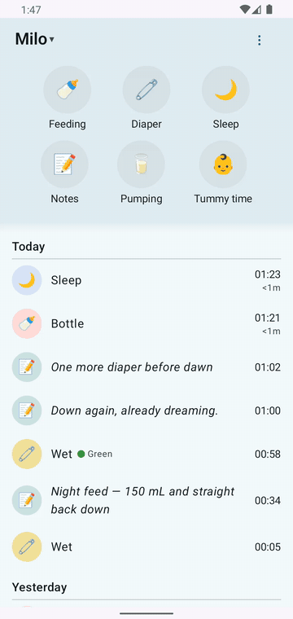

# 40 — Offline & sync (spec §6.3) — QA flow doc

**Purpose:** verify the offline-first guarantees — local-first writes with PENDING badges, oldest-first replay, FAILED surfacing with a resolution path, timer + queue survival across process death, and the airplane-mode timer flow.

## How to verify

- Scripts: `scripts/qa/server.sh stop|start|wait` (server-down flavor), `scripts/qa/offline.sh on|off` (airplane flavor — use one flavor per run, both verified), `scripts/qa/applog.sh` (`BB/SYNC drain/dispatch/rejected`), `scripts/qa/server-log.sh` (replayed requests in outbox order), `scripts/qa/api.sh` (post-conditions).
- Tags: `dashboard/sync_chip`, `dashboard/badge_pending`, `dashboard/badge_failed` (badge tags absent from a11y tree in the broken states — finding #8; verify visually via screenshots + text `Will sync`).
- Current UI (2026-10-19): offline → header "Offline" chip + "Will sync" pill on pending entries; on recovery the queue drains (oldest-first) and the badges clear — both visible in the demo clip below.
- Expected requests: while offline — none to the server (access log flat); on recovery — queued `POST`s in creation order (oldest first), each 201; a rejected op logs `BB/SYNC … op #N … rejected:` and shows the server's `non_field_errors` text.

## Multi-device convergence (0.3.0)

The outbox drain PUSHES local writes; pulls reconcile REMOTE changes. Pull triggers (0.3.0):
app resume (lifecycle ON_RESUME), a ~60 s periodic tick while the dashboard is resumed
(stopped on pause; pulls skip/queue-safe via mutex), pull-to-refresh / Sync-now chip, and the
initial dashboard load. Timer reconciliation runs per pull for EVERY child (not just the active
one): a server timer another device ended (stop = DELETE timer) is dropped from the local strip
on the next pull; an edit-in-place to a SYNCED historical entry converges when the entry is
within the pulled window (newest 200/type by end-time — edits don't bump that sort, so entries
older than the window still need the web UI; documented limitation).

How to verify: `DashboardMultiDeviceSyncTest` (5 red-first pins incl. out-of-window edit and
vanished-timer reconcile) + checklist 15. Device evidence 2026-11-01: foreground after remote
stop → `BB/UI: app resumed: reconcile pull` → `BB/TIMER: drop stale SLEEP serverId=615 (gone on
server)`.

## Observed — scenario by scenario (spec §6.3)

**Watch it happen — going offline and draining.**

*32 s — the airplane flavor of the PENDING → replay path: the note is queued while offline ("Will sync" pill + header "Offline" chip), then drains with the correct timestamp the moment the network returns (`POST /api/notes/` 201) and the badge clears.*

**1. Server down → create → PENDING → replay (PASS).**
`server.sh stop` → created offline: note ("offline note one"), diaper (wet), note two (guard fired: "Note logged 1 min ago. Add anyway?" → Add), sleep B, sleep D (guard: "Sleep logged just now" → Add) → outbox queued (BB/SYNC `drain … NetworkDown`). `server.sh start` → on next app start the drain replayed **oldest-first, all 201**: `#16 CREATE NOTE`, `#17 CREATE CHANGE`, `#18 CREATE NOTE`, `#19 CREATE SLEEP`, `#20 CREATE SLEEP` (server log lines in order) ✓. PENDING badge verified on sleep D's row after relaunch ("Will sync", screenshot 13/14) ✓. The offline diaper/nap appear in the CareDashboard widget immediately after the drain (widget drain-completion refresh ✓, checklist 10).

**2. Overlap rejection → FAILED → resolution (FAILS — P1, finding #3).**
Probed the server rule first via `api.sh PATCH` (same-type only: sleep overlapping sleep → 400 `non_field_errors "Another entry intersects… Conflicting entry: <a href=…>"`; pumping overlapping **sleep** is accepted — the server checks overlap per model, matching core/models.py). Through the app (online): edited a sleep's START −15 m to overlap another sleep → app sent `PATCH /api/sleep/7/` → **400** (`BB/SYNC … op #15 EDIT rejected: Another entry intersects…` — the app parsed the conflicting entry). Expected per spec §3.8/UX §4: non-destructive "Can't save changes" dialog with the parent-language reason, sheet stays open. **Actual:** sheet closed silently; no dialog; no FAILED badge anywhere; the affected entry's row disappeared from the timeline (persisting across restart and pull-to-refresh); the header chip counts "1 failed" but tapping it only runs "Sync now" — the failed op stays parked and **Edit / Retry / Delete-locally are unreachable**. The failed op never blocked other entries' sync (verified: 5 later ops replayed fine) — that part of §6.2 holds.

**3. Airplane mode mid-timer (PASS).**
Airplane on → sleep timer started → kept ticking offline → strip Save after ~63 s → duplicate guard fired ("Sleep logged 2 min ago. Add anyway?") with the timer still running behind the dialog → Add → entry queued → airplane off → `POST /api/sleep/` 201 with **wall-clock-correct start/end** (start = when the timer started offline, end = stop time). Screenshot 15 shows airplane-mode icon + two running timers + the guard dialog.

**4. Kill app offline with pending events + running timer (PASS).**
Force-stop with 5 queued ops and a running pumping timer → relaunch (still offline) → pumping timer restored, wall-clock-correct (00:00:23), pending entries intact ("Will sync" badge on sleep D) ✓ (spec §6.3.4, §3 timer restore).

**5. Two devices / near-duplicates:** not tested (single emulator) — accepted tradeoff per spec §6.3.5.

**6. 401 during sync (SKIPPED with note).** No debug mechanism exists to revoke the session without touching the admin API key used by the QA scripts; per mission instructions the scenario is skipped. The session-expired login prefill path exists in code (LoginViewModel reads the stored session for prefill) but could not be triggered black-box.

## Branches / states

| State | Result |
|---|---|
| Create offline | Local row + PENDING, op queued |
| Drain | Oldest-first POSTs, all 201, badges clear |
| Failed create/update op | Parked, retried with backoff, does not block queue |
| FAILED entry UI | **BROKEN** — no badge/row/dialog (finding #3) |
| Offline timer | Ticks, saves PENDING, syncs with true times |
| Process death offline | Timer + queue intact |

## Screenshots

`docs/screenshots/new-app/flows/05-sync-states-01…06` — online conflict-dialog attempt (dashboard after silent close), chip states, pending badge after relaunch, airplane timer + guard dialog, final states.

## Deviations from spec

- **P1** — finding #3 (rejection surfacing + resolution path broken; spec §3.8, §6.2, §6.3.2 unmet).
- No "Offline" chip: while offline the header keeps showing the stale "N failed" chip and never shows the "Offline" state (UX §5 SyncStatusChip table). Rolled into finding #3's fix or tracked separately as P3.
- **Update 2026-10-19:** shipped — header "Offline" chip + "Will sync" pill on pending entries; on recovery the entry drains and the badge clears. The offline-indicator concern recorded above (rolled into finding #3) is resolved; the historical notes are left as recorded.
- Scenario 6 skipped (no debug mechanism), per mission instruction.
