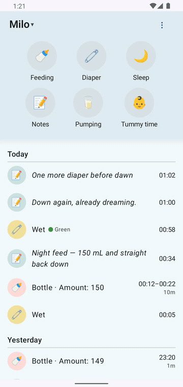
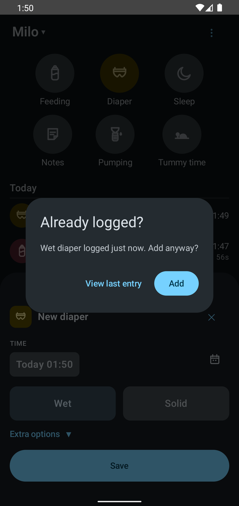

# Logging a feed, diaper, or nap

Everything starts from six big buttons at the top of the screen: **Feeding, Diaper, Sleep, Notes, Pumping, Tummy time**. They never move, they're sized for a thumb, and nothing competes with them. One child at a time — switch kids from the name at the top and the whole page follows.

## Tap once, done

**Diaper** and **Notes** save instantly. A diaper is three taps: Diaper, Wet (or Solid), Save. Save stays grey until you've picked at least one thing, so an empty panel can't save a blank entry. Color is a single swipe-and-pick strip (one color — the server keeps one), and amount and note are optional. Everything is stamped the moment you save; got the time wrong? Tap the row afterwards and fix it. Notes work the same way: type, save.

## Or start a timer

**Feeding, Sleep, Pumping,** and **Tummy time** run a timer. Tap once to start, tap the same button again to stop and save. A running timer shows up as a card right under the buttons with a live counter, and it keeps counting even if you close the app — restarts too.

The app also remembers what you logged last, per child, and starts there. If it's formula in a bottle eight times a day, it's formula in a bottle on tap one.

## "Add anyway?"

Logging the same thing twice within a few minutes is easy to do at 3 a.m. So the app asks before double-logging: **"Diaper change logged 1 min ago. Add anyway?"** One tap either way, and it never blocks you. If you tapped twice by accident, the question is your chance to skip the duplicate; if both were real, Add is right there.

## Where it lands

Every save appears at the top of **Today** right away. No spinner, no refresh — the new row is the receipt.
