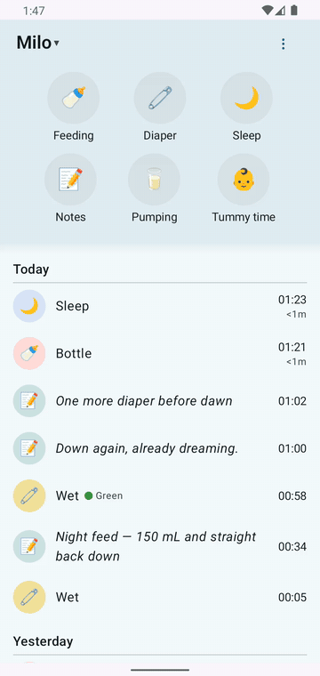

# No signal? Keep logging.

The park with no bars, the basement, the airplane, the server that's down for maintenance. Logging doesn't care.

## How it works

Every save lands on your phone first, instantly. The app syncs to your server in the background whenever it can reach it — you never wait on a spinner.

- While you're offline, a small **Offline** chip shows at the top of the screen, and entries waiting to go up wear a quiet **Will sync** pill. Nothing red, nothing spinning. Your entry is right there in the list.
- When the connection comes back, everything queued goes up in order, oldest first, on its own — and the pills clear.

## If the server says no

Servers have rules — a nap can't overlap another nap, for example. If something you saved gets refused, the entry gets a small warning badge in the list. Tap it and you get the reason in plain language — **"This overlaps the 11:29–11:33 nap."** — and your ways out: **Edit** it, **Retry**, or **Delete** it from the app. A refused entry never blocks anything else from syncing, and it's never dropped silently. No dead ends.

## Timers included

Start a sleep timer in airplane mode, land, save. The entry keeps the true start and end — when the nap actually happened, not when you got signal. And it's all close-the-app-proof: queued entries and running timers are still there after the app is killed or the phone restarts.
