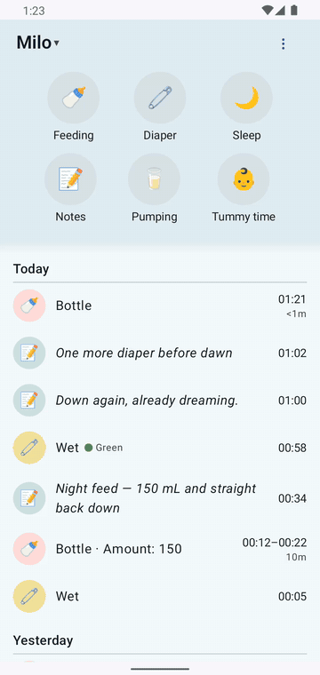
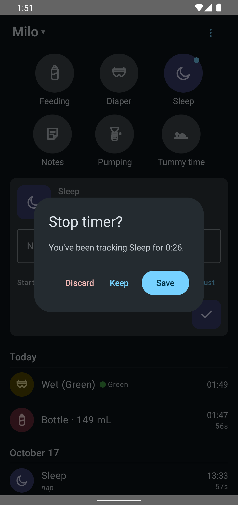
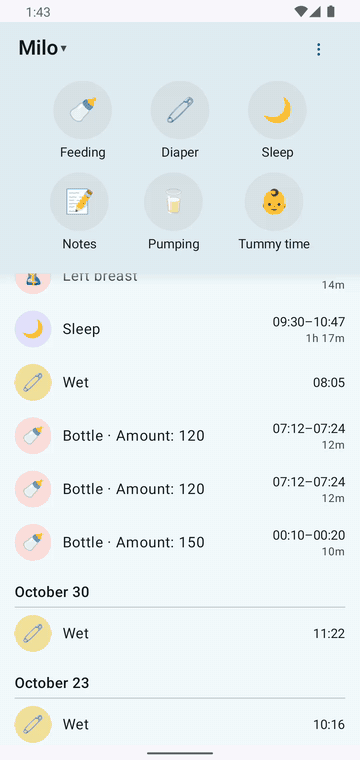

# Timers, and fixing a time you got wrong

Most logging happens *after* the fact, from memory, a little wrong. Both halves are covered: timers that are hard to mess up, and an editor for the times that were wrong anyway.

## Starting and stopping a timer

Tap **Sleep** (or Feeding, Pumping, Tummy time) once to start. The timer becomes a card under the buttons, counting up. Tap the same button again to stop, and one of two things happens:

- **Over ten seconds:** a calm dialog asks — **"Stop timer? You've been tracking Sleep for 1:07."** — with **Save** as the obvious answer, plus Discard, and Keep for when you tapped by accident and the nap isn't over.
- **Under ten seconds:** the tap is treated as what it almost always is — a double-tap — and discarded quietly, no entry, no fuss. A pocket-tap shouldn't be able to log a fake nap.

Timers survive closing the app, restarting your phone, and being offline — and they save the times things actually happened, not the times you got around to it.

## Fixing a time

Tap any entry in the list — today's nap, last night's feed — and an editor opens with real clock and calendar pickers. Set 2:15 instead of 2:45, fix when the feed actually started, done. Two details that matter:

- **Move a start time and the length follows.** A feed that started twenty minutes later is still the same feed; you fix one clock, not two.
- **Impossible edits can't save.** End before start gets a plain-language reason, and the save button simply stays off. Nothing breaks, nothing is lost.

Deleting works the same way: tap the entry, Delete, confirm.

## The escape hatch

Long-press any entry to open that same entry on your server's web UI. The web always has more fields than this app — that's intentional. This app doesn't try to replace the web UI; it just makes the common ten seconds faster.
