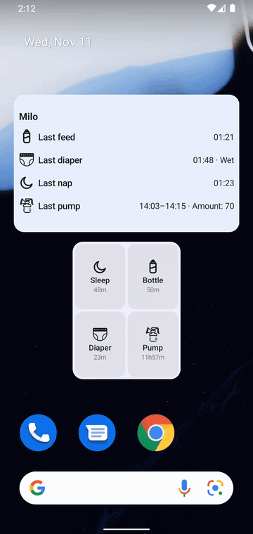

# Glanceable widgets

Two home-screen widgets, so the most common questions never require opening the app.

## Quick actions

A small widget with four buttons: **Sleep, Bottle, Diaper, Pump**.

- Tap **Sleep** and the sleep timer starts. The app doesn't even open — the tile flips to show the running time, and your phone stays exactly where it was. Tap it again when the nap ends.
- **Diaper** and **Bottle** open the app with the right form ready — a diaper needs a wet-or-solid answer, and the widget honestly can't guess that for you.
- Idle tiles quietly show how long it's been: `45m`, `1h30m`, `2d` since the last one of that kind.

## Care dashboard

The bigger widget answers the question you get asked most: *"when did she last eat?"*

- **Last feed 1h · 120 mL**, then last diaper, last nap, last pump — one glance, amount included.
- When a timer is running, that comes first: **"Asleep since 13:00 · 12m elapsed."** It clears when the timer is saved.
- Tapping a row opens the app, where the truth lives.

Both widgets update right after you log something, and at least every 15 minutes even when you don't. You pick the child and the four buttons when you place a widget; long-press to resize it.

One honest limit: a widget follows **one child**. Two kids means two widgets — or opening the app.
