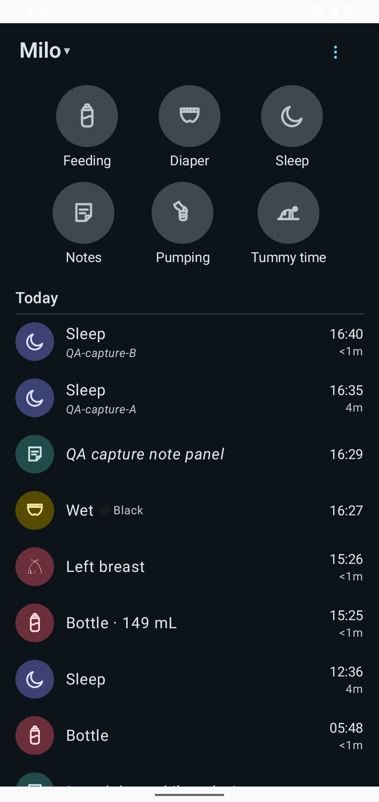
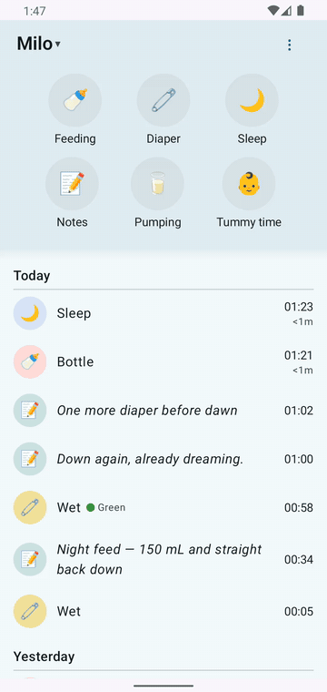

# An offline-first Android client for Baby Buddy

Log feeds, diapers, sleep, and more — even with no signal. It syncs to your own server when you're back on WiFi.

*1:47 a.m. Like most of this project.*

- :material-alarm:{ .lg .middle } **Last feed — 1h · 149 mL**

    The 3 a.m. question, answered in one glance. Amount included, no math.

- :material-bed:{ .lg .middle } **Asleep since 23:32**

    The 3 a.m. relief. Started with one tap, still counting.

[:material-download: Get the app](get-the-app.md){ .md-button .md-button--primary }

## See it in action: no signal

The best trust argument we have. Airplane mode on, save a note, a quiet "Will sync" pill appears. Airplane mode off, it syncs itself — nothing red, nothing lost.

## What it does

- **Six big buttons** — Feeding, Diaper, Sleep, Notes, Pumping, Tummy time. Nothing competes with them.
- **Tap once to log; tap again to stop a timer.** A second tap under ten seconds counts as a mis-tap and logs nothing — a pocket-tap can't invent a nap.
- **A duplicate guard that asks instead of double-logging.** *"Diaper change logged 1 min ago. Add anyway?"*
- **Fix any time in the app** with a real clock-face picker. Move a feed's start and its length follows.
- **The escape hatch:** long-press any entry to open it on your server's web UI. The web always has more fields — on purpose.
- **Home-screen widgets** to start a nap timer and read the last feed without opening anything.

## Two doors

- :material-book-open-variant:{ .lg .middle } **I want to use it**

    The guide: logging, timers, offline, widgets — one short page each.

    [:octicons-arrow-right-24: Read the guide](guide/logging.md)

- :material-hammer-wrench:{ .lg .middle } **I want to see how it's built**

    The workshop: the functional spec, QA evidence, and the AI-agent team.

    [:octicons-arrow-right-24: Open the build docs](build-docs.md)

## Field notes from a tired parent

> "One tap. The app never opened. This is the entire reason I would keep this app. I have never once successfully logged a nap on the old app."
>
> "I fixed a sync conflict without understanding a single technical word. That never happens."

— Sam, the other parent, after a day with the beta. [More field notes — this way into the workshop](flows/new-app/80-persona-feedback/sam.md)
