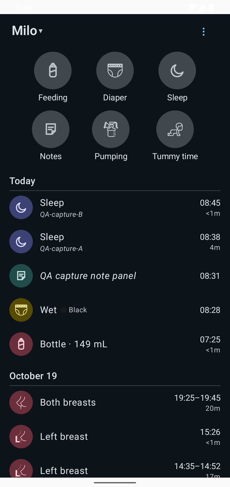
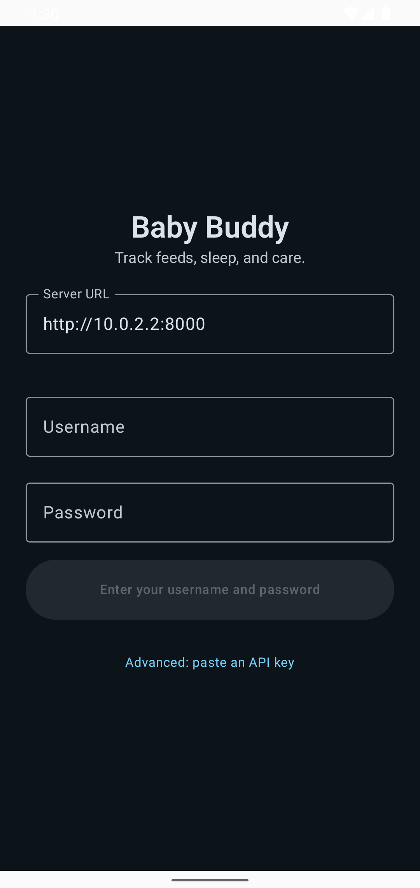
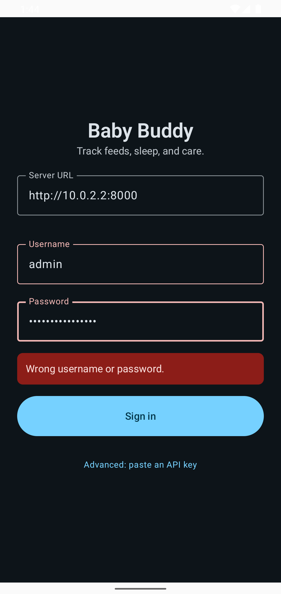
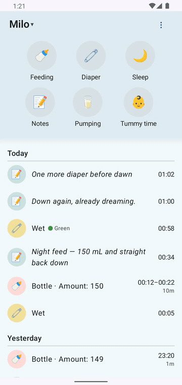
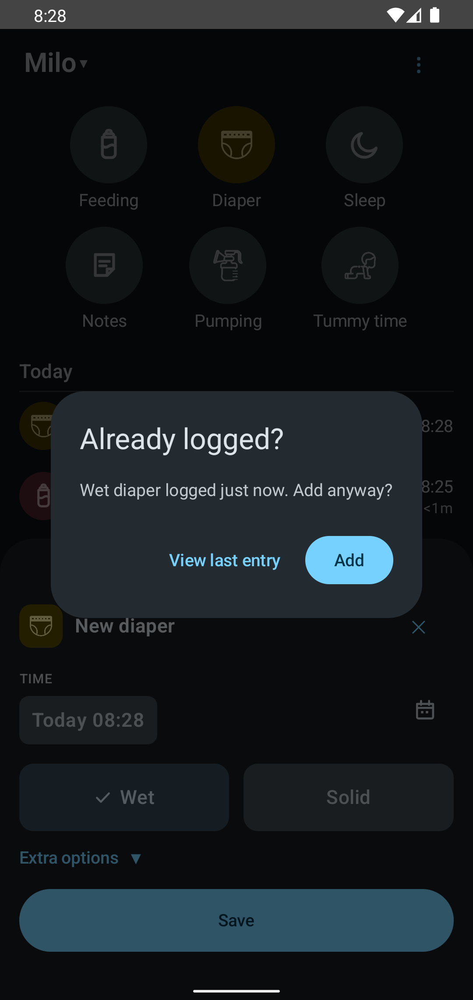
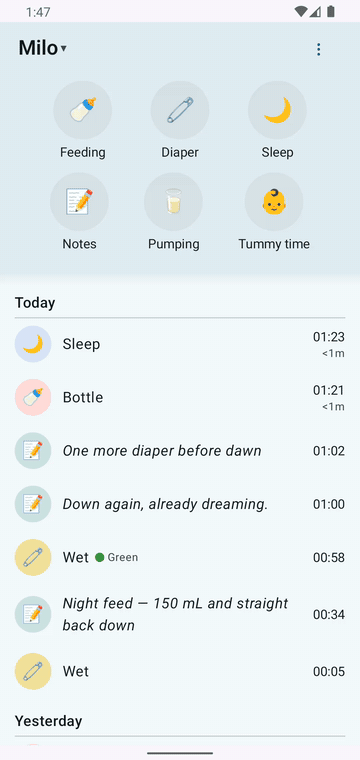

# Quick start

Here is a quick, no-choices path to install Dandle and take it for a test drive. No feature tour, no configuration maze: get the server up, get the app on your phone, connect the two, and log a feed.



*1:47 a.m. Like most of this project.*

<div className="stat-cards">
  <div className="stat-card">
    <div className="stat-label">The 3 a.m. question</div>
    <div className="stat-value">Last feed — 1h · 149 mL</div>
    <div className="stat-hint">Answered in one glance. Amount included, no math.</div>
  </div>
  <div className="stat-card">
    <div className="stat-label">The 3 a.m. relief</div>
    <div className="stat-value">Asleep since 23:32</div>
    <div className="stat-hint">Started with one tap, still counting.</div>
  </div>
</div>

## Requirements

- **An Android phone running Android 10 or newer.** Check under Settings → About phone → Android version.
- **Your own Baby Buddy server.** Baby Buddy is the free, open-source tracker this app talks to. It runs on a computer you control — a Raspberry Pi in a closet counts. No cloud account, no sign-up: after setup, everything stays between your phone and your server.
- About ten minutes, plus an evening if you're also setting up the server for the first time. If that sounds like someone else's hobby, it can be: you or a geeky friend can do it in an evening.

## Step 1: Get your server running

Already have a Baby Buddy server? Skip to [Step 3](#step-3-connect).

One Docker line gets you a server:

```bash
docker run -d --name babybuddy -p 8000:8000 -v babybuddy_config:/config lscr.io/linuxserver/babybuddy
```

Browse to your server's address (for example `http://your-server-ip:8000`) and sign in — a fresh container answers to the default login `admin` / `admin`. That's the whole setup; see [the Baby Buddy project](https://github.com/babybuddy/babybuddy) for what the server does.

## Step 2: Install the app

**Status: beta.** The app builds, installs, and runs against a real server, but it is **not on Google Play or F-Droid yet** — so today you build it from source. You — or the geeky friend — need [Android Studio](https://developer.android.com/studio) and about ten minutes:

1. Install Android Studio (it provides the Java and Android tools the build needs).
2. Download this project — the green **Code** button on the repository page, or `git clone` if you prefer.
3. From the project folder, build it:

```bash
source scripts/dev-env.sh && cd app && ./gradlew :app:assembleDebug
```

The first command just picks the right Java version — Gradle is picky about that. The finished app is written to `app/build/outputs/apk/debug/app-debug.apk`. Copy it to your phone and tap it to install; Android asks you to allow installs from this source, which is normal for anything outside the stores. If you'd rather not touch a terminal, open the `app/` folder in Android Studio and press **Run** with your phone plugged in.

When the first store release lands, this step becomes a normal download-and-tap — keep an eye on the repository's **Releases**. No date promised; it ships when it's ready.

## Step 3: Connect

Open the app. First launch asks for exactly two things:

- your **server's address** — the one from Step 1, e.g. `http://192.168.1.20:8000`, and
- your **Baby Buddy login**.

Nothing else. No account with us, no cloud — the app talks to your server and nowhere else. (If your server runs on plain `http://` — common at home — the app asks once to confirm; that's expected.)





## Try it: log a feed

Six big buttons live at the top of the screen: **Feeding, Diaper, Sleep, Notes, Pumping, Tummy time**. Tap **Feeding**, pick a type, save — the entry lands at the top of **Today** immediately, no refresh. The app remembers what you logged last, per child, and starts there: if it's formula in a bottle eight times a day, it's formula in a bottle on tap one.



Two habits worth borrowing while you're in there:

- **Timers:** Feeding, Sleep, Pumping, and Tummy time run a timer — tap once to start, tap the same button again to stop and save.
- **The duplicate guard:** logging the same thing twice within a few minutes is easy at 3 a.m., so the app asks first — *"Diaper change logged 1 min ago. Add anyway?"* One tap either way, never a blocker.



Made a mistake? Tap any entry to fix its time in the app with a real clock picker — or long-press it to open that same entry on your server's web UI, which always has more fields than this app. On purpose.

## No signal? It still works

The best trust argument we have. Airplane mode on, save a note — a quiet **Will sync** pill appears. Airplane mode off, it syncs itself. Nothing red, nothing lost.



## Where to go from here

- **[The guide](../guide/logging.md)** — logging, timers and fixing a time, offline, widgets: one short page each.
- **[Widgets](../guide/widgets.md)** — start a nap timer without even opening the app, and read the last feed from your home screen.
- **[Your data & security](../guide/data-and-privacy.md)** — what leaves your phone, what never does, and why the app refuses bad certificates instead of bypassing them.
- **[Get the app](../get-the-app.md)** — the honest picture of today's install options and what a release will change.
- **Curious how this is built?** [The build docs](../build-docs.md) are the workshop: the functional spec, the QA evidence, and the AI-agent team behind the beta.

## Field notes from a tired parent

> "One tap. The app never opened. This is the entire reason I would keep this app. I have never once successfully logged a nap on the old app."
>
> "I fixed a sync conflict without understanding a single technical word. That never happens."

— Sam, the other parent, after a day with the beta. [More field notes — this way into the workshop](../flows/new-app/80-persona-feedback/sam.md)
